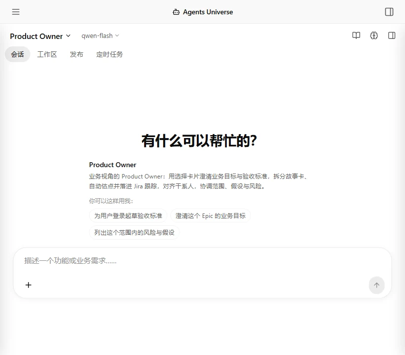

# Agents Universe

自托管的多智能体工作台：**十个内置智能体**组成一个团队，围绕同一个项目工作区、知识库和对话历史协作；还能把真实的聊天记录与工具调用**炼化**成可复用的 Skill。



- **十个角色，按需组队**：Product Owner 拆需求、Tech Lead 写实现、Quality Assurance 验结果，数据分析、办公文档、渗透测试、智能客服与平台定制角色按项目加入。
- **炼化 Skill**：选几次真实会话，平台把触发场景、处理步骤、工具顺序、失败经验提炼成一份 `guidance` 技能草稿，审阅后即可变成项目技能。
- **单镜像自托管**：一个 Docker 镜像 = nginx（前端）+ FastAPI（API/WS）+ 进程内调度器，外加 PostgreSQL 与 Redis。
- **模型自带**：Anthropic / OpenAI / Azure OpenAI / Gemini / 任意 OpenAI 兼容端点；API Key 经 AES-256-GCM 加密，只存在你自己的数据库里。
- **文件即配置**：智能体、技能、工作流、知识全部是仓库里的 Markdown / YAML，可审阅、可版本化，不藏在服务端数据库。

---

## 目录

- [十个智能体](#十个智能体)
- [炼化 Skill](#炼化-skill)
- [快速开始](#快速开始)
- [架构](#架构)
- [目录结构](#目录结构)
- [配置](#配置)
- [开发与测试](#开发与测试)
- [部署、升级与回滚](#部署升级与回滚)
- [安全边界与已知限制](#安全边界与已知限制)
- [文档、仓库与许可](#文档仓库与许可)

---

## 十个智能体

十个智能体都定义在 [`agents/*.agent.md`](agents/) 中，每个文件声明自己的 `slug`、显示名、系统提示词、工具集、技能与工作流。它们共享同一个项目工作区、知识库、记忆和对话历史，但职责边界、工具权限和确认规则各自独立。

### 团队总览

| 类别 | 智能体 | 一句话定位 | 典型任务 |
| --- | --- | --- | --- |
| 研发交付 | [Product Owner](agents/project-owner.agent.md) | 业务视角的需求负责人 | 澄清目标与验收标准、拆故事卡、估点、落 Jira |
| 研发交付 | [Tech Lead](agents/tech-lead.agent.md) | 实现侧的技术负责人 | 读代码、写实现、跑测试、提 PR、PR 审查、排障、架构权衡 |
| 研发交付 | [Quality Assurance](agents/quality-assurance.agent.md) | 业务结果与自动化的验证者 | 测试设计、Playwright 脚本、回归、证据与 Jira 汇报 |
| 数据与文档 | [Data Analyst](agents/data-analyst.agent.md) | 对齐指标口径的分析师 | 取数、异动归因、例行报告、图表看板、Excel |
| 数据与文档 | [Office Assistant](agents/office-assistant.agent.md) | 交付物制作助手 | PPT、Excel、Word、PDF、reveal.js 网页演示、ZIP |
| 安全 | [Pentest Expert](agents/pentest-expert.agent.md) | 授权范围内的白盒渗透专家 | 攻击面测绘、代码审计、非破坏 PoC、PTES 报告 |
| 客服 | [Customer Service](agents/customer-service.agent.md) | 严格依据知识库的客服 | FAQ、订单查询、退换货、转人工、问答回写 |
| 平台定制 | [Project Customization Expert](agents/project-customization-expert.agent.md) | 项目知识上下文的定制者 | 结构化访谈、知识建库与裁剪、项目规则 |
| 平台定制 | [Agent Customization Expert](agents/agent-customization-expert.agent.md) | 智能体定义的设计者 | 职责边界、工具/技能组合、项目专属智能体 |
| 平台定制 | [External System Integration Expert](agents/external-system-integration-expert.agent.md) | 外部系统接入专家 | API/MCP 接入、认证与密钥、接口验证、联调 |

### 1. Product Owner

**定位**：业务视角的 Product Owner。先把「为什么做、做到什么算完成」说清楚，再谈实现。

**什么时候找它**：需求只有一句话、验收标准缺失、需要拆故事卡/估点/进 Jira、需要对齐干系人的范围与假设。

**它能做什么**：

- 用选择卡片澄清业务目标、验收标准和边界，不替业务方做未经确认的假设。
- 拆分故事卡，自动估算故事点，并把任务、优先级和依赖落到 Jira。
- 对齐范围、假设与风险，输出可执行的迭代计划。
- 用 `demo-maker` 生成单文件演示页，先让干系人看到「长什么样」。

**关键能力**：`integration/jira-analyzer`、`integration/confluence-reader`、`estimation/story-point-estimator`、`generation/demo-maker`；工作流 `demo-generation`、`knowledge-ingestion`。

### 2. Tech Lead

**定位**：实现侧的技术负责人。给一张 Jira 卡，就能从读代码走到创建 PR。

**什么时候找它**：实现一张卡、评审/合并 PR、排查阻塞、评估架构权衡、写自定义脚本或单文件 demo。

**它能做什么**：

- 读仓库代码、写实现、跑测试、创建 PR；按 Jira 验收标准逐条核对。
- 审查 PR 的正确性与风险：检查项、边界处理、权限、空值、超时、调用点漂移、测试缺口。
- 设计并运行自定义脚本，实现单文件演示页，处理跨仓库或跨服务的阻塞问题。
- 在不确定的技术决策上给出 2–3 个方案与取舍，必要时用 `user_confirm` 请用户拍板。

**关键能力**：`integration/pr-review-manager`、`integration/git-pr-manager`、`integration/jira-implementer`、`generation/custom-script-writer`；工作流 `tech-lead-jira-implementation-to-pr`。

### 3. Quality Assurance

**定位**：业务视角的 Quality Assurance。验证用户与业务结果，而不是只跑通页面。

**什么时候找它**：需求验收、回归测试、Playwright 自动化、缺陷复现、发布前质量把关。

**它能做什么**：

- 设计测试用例与系统测试计划，准备测试数据，覆盖正常、异常、权限与边界。
- 生成并运行 Playwright 脚本与回归套件，保留截图、录屏等执行证据。
- 把测试结论、缺陷和证据简洁地汇报到 Jira，必要时发布测试报告页。
- 把可复用的测试模式沉淀到项目知识库。

**关键能力**：`testing/test-designer`、`testing/system-test-planner`、`testing/release-regression-manager`、`generation/playwright-generator`；工作流 `whole-system-test-planning`、`automation-workflow-playbook`。

### 4. Data Analyst

**定位**：对齐项目指标口径的数据分析师。先确认口径，再取数。

**什么时候找它**：指标异动、经营分析、例行周报/月报、看板搭建、取数 SQL、Excel 数据整理。

**它能做什么**：

- 按项目知识库里的指标口径取数，覆盖业务库与本地文件。
- 做异动归因：拆维度、看趋势、对比同比/环比，给出可验证的结论。
- 产出 Markdown 报告、PNG 图表、自包含 HTML 看板与格式化 Excel 工作簿。
- 把数据源、口径和取数模式写回项目知识，减少下次重复确认。

**关键能力**：`analysis/sql-crafter`、`analysis/metric-investigator`、`analysis/dataviz`、`analysis/report-writer`、`office/xlsx`；工作流 `metric-deep-dive`、`recurring-report`、`data-source-onboarding`。

### 5. Office Assistant

**定位**：把项目知识和对话内容变成可交付的办公文件。

**什么时候找它**：汇报 PPT、数据表、Word 文档、PDF、网页演示、材料打包。

**它能做什么**：

- 生成 `.pptx`、`.xlsx`、`.docx`、PDF 与自包含 reveal.js 网页演示。
- 支持 ZIP 压缩打包与解压，交付物通过 `/api/media/` 鉴权链接送达。
- 只从项目知识和用户提供的内容取材，不编造数字、来源或结论。
- 按模板统一版式、字号、图表与页脚，减少人工返工。

**关键能力**：`office/pptx`、`office/xlsx`、`office/docx`、`office/pdf`、`office/web-slides`、`office/zip`。

### 6. Pentest Expert

**定位**：授权范围内的白盒渗透测试专家。先授权，后动手。

**什么时候找它**：安全评估、代码审计、攻击面梳理、漏洞验证、渗透报告。

**它能做什么**：

- 先确认授权范围与禁止事项；范围外不探测、不利用。
- 测绘攻击面，静态审计源码，定位入口、权限边界与危险数据流。
- 用非破坏性 PoC 动态验证发现，保留可复现证据。
- 交付 PTES 结构报告：风险等级、复现步骤、影响、修复建议。

**关键能力**：`security/pentest-scope-guard`、`security/recon-and-attack-surface`、`security/static-code-audit`、`security/finding-validation`、`security/pentest-report-writer`；工作流 `full-project-pentest`。

### 7. Customer Service

**定位**：严格依据项目知识库回答的智能客服。没有答案就明确说，不编造。

**什么时候找它**：FAQ、服务政策解释、订单/物流查询、退换货引导、投诉受理与转人工。

**它能做什么**：

- 从 FAQ、服务政策、话术库检索答案，金额、时效、赔付必须给出依据。
- 经已配置的自定义 API / MCP 只读查询业务系统，不越权、不泄露其他用户信息。
- 无法确认、用户要求人工、连续两轮未解决或涉及投诉/赔付时转人工并建工单。
- 把验证过的新问答对回写到知识库，形成可复用资产。

**关键能力**：`support/customer-reply`、`support/escalation`、`interaction/user-confirm`。

### 8. Project Customization Expert

**定位**：项目级知识、配置、工作区规则与集成约定的定制者。

**什么时候找它**：新项目冷启动、知识库太乱或太薄、需要把业务规则/术语/流程沉淀成可维护的项目上下文。

**它能做什么**：

- 通过结构化访谈，把业务目标、角色、流程、规则、术语整理成知识条目。
- 建立与裁剪知识库，补齐交叉引用，控制知识完整度与维护成本。
- 为任意领域项目建立隔离、可维护的运行上下文。
- 把项目专属约定写进项目工作区，而不是污染全局模板。

**关键能力**：`integration/repo-file-reader`、`interaction/user-confirm`；工作流 `knowledge-ingestion`。

### 9. Agent Customization Expert

**定位**：智能体定义的设计者与维护者。

**什么时候找它**：要新建一个角色、要给现有智能体收窄权限、要检查工具/技能声明是否真实可验证。

**它能做什么**：

- 设计职责边界、工具声明、技能/工作流组合与确认规则。
- 在当前项目内创建、检查或收窄项目专属智能体。
- 保证能力声明真实、最小、可验证，不堆砌用不上的工具。
- 把「这个角色该做什么、不该做什么」固化成可审阅的定义文件。

**关键能力**：`integration/repo-file-reader`、`interaction/user-confirm`；工作流 `knowledge-ingestion`。

### 10. External System Integration Expert

**定位**：外部系统安全接入专家。

**什么时候找它**：接第三方 API、接 MCP 服务器、配置认证与密钥、接口联调、排查集成问题。

**它能做什么**：

- 完成 API 与 MCP 服务器接入、认证与密钥配置；明文不进对话。
- 验证接口契约、错误码、超时与重试，做联调排障。
- 优先通过已配置的集成完成调用，避免在对话里临时拼请求。
- 把验证过的接口规则写回项目知识，供后续智能体复用。

**关键能力**：`integration/custom-api-onboarding`、`integration/custom-api-consumer`、`integration/kong-reader`、`integration/self-adapt-db-access`；工作流 `knowledge-ingestion`。

### 怎么选、怎么协作

| 你的问题 | 先找谁 |
| --- | --- |
| 需求不清、验收标准没写 | Product Owner |
| 要把需求做成代码 / 评审 PR | Tech Lead |
| 要验收、回归、自动化测试 | Quality Assurance |
| 指标对不上、要取数/做看板 | Data Analyst |
| 要出 PPT / Excel / Word / PDF | Office Assistant |
| 要做安全评估 / 代码审计 | Pentest Expert |
| 要回答客户问题 / 转人工 | Customer Service |
| 新项目要建知识库 / 定规则 | Project Customization Expert |
| 要新建或收窄一个智能体 | Agent Customization Expert |
| 要接外部 API / MCP | External System Integration Expert |

协作机制：

- **一个项目一份上下文**：项目工作区、知识库、记忆、对话历史共享；每个对话选择一个智能体主答。
- **@ 提及与委派**：在对话里 `@agent` 切换主答；智能体可用 `delegate_agent` 把子任务交给其他角色，带深度上限、目标白名单与全局开关。
- **项目级覆盖**：项目里的 `agents/`、`skills/`、`workflows/` 可以覆盖全局同名定义，适合客户/项目专属定制。
- **按轮加载**：技能由触发词或 `/slug` 命中后注入本轮提示词；工作流按阶段推进；知识按需检索/动态加载。

---

## 炼化 Skill

「炼化 Skill」是平台的独立入口（左侧一级导航，路由 `/distill`）：把**当前账号自己的聊天记录与工具调用记录**汇总成一份可复用的 `guidance` 技能草稿。

它解决的问题是：一次排障、一次分析、一次评审的过程只留在对话里，下次换个人、换个时间又要重来。炼化把「这次是怎么做的」变成「下次照着做」的文件。

### 输入与边界

| 项 | 规则 |
| --- | --- |
| 会话范围 | 当前账号自己的、`status=active`、非 `publish` 的会话 |
| 会话数量 | 最多 50 个（「汇总全部」按最近更新取 50 个，超出截断） |
| 每会话消息 | 最多 80 条（取最近 80 条） |
| 总消息量 | 最多 3,000 条 |
| 单条摘要 | 400 字，超出截断 |
| 工具调用 | 可选；勾选后统计工具名、参数键、调用次数、先后顺序与失败 |
| 脱敏 | `sk-*`、`Bearer *`、本机绝对路径、`password/token/secret/api_key` 值统一替换 |
| 生成方式 | 确定性聚合，**不调用外部大模型**；同样输入得到同样草稿 |
| 输出 | 仅预览，不自动写盘；由用户复制或下载 `.md` |

### 使用步骤

1. 打开左侧「炼化 Skill」，在会话列表里搜索/分页选择记录；可「全选本页」或「汇总全部会话」。
2. 勾选是否「包含工具调用记录」。
3. 点「生成 Skill」，在右侧预览草稿。
4. 复制或下载 `.md`，按实际情况删改：补领域判定、阈值、检查清单，删掉一次性信息。
5. 保存到项目 `skills/` 或全局 `agents/skills/`，下次用触发词或 `/slug` 加载。

### 生成逻辑

实现位于 [`packages/api/src/api/routers/skills_distill.py`](packages/api/src/api/routers/skills_distill.py)，核心是 `_build_skill`：

| 草稿部分 | 来源 |
| --- | --- |
| `triggers` | 会话标题（去重，最多 6 条） |
| 适用场景 | 会话标题 |
| 典型需求 | 用户消息的前 160 字（去重，最多 10 条） |
| 标准流程 | 工具调用的先后转移，按出现次数排序（最多 6 条） |
| 工具使用规范 | 工具调用次数与常见参数键（最多 12 个工具） |
| 已知失败与处理 | `status=error` 或输出含 `error` 的工具调用 |
| 产出参考 | 助手回复的前 160 字（最多 5 条） |
| 质量检查清单 | 固定的数据来源、工具核对、脱敏、可追溯四项 |

输出是一份带 frontmatter 的 Markdown：

```yaml
---
slug: "distilled-xxxxxx-20261126-121944"
description:
  zh-CN: "从 1 个会话、17 条消息、12 次工具调用中提炼出的工作方法……"
type: "guidance"
triggers:
  - "双11大促库存超卖与支付回调重复排查"
tools:
  - sql_query
  - filesystem
  - shell
  - knowledge_rw
---
```

### 从草稿到可用的 Skill

草稿只回答「这次用了什么工具、先后顺序是什么」，不会自动理解业务。真正可用的 Skill 需要补上：

- **判定表**：看到什么现象、查什么数据、得出什么结论。
- **阈值与口径**：数字、单位、时间窗口、成功/失败标准。
- **可执行模板**：SQL、DDL、命令、配置片段。
- **验证与回滚**：怎么证明修好了，出问题怎么退回。
- **禁止事项**：这次踩过的坑，下次不要再踩。

一次完整演练见 [`examples/skill-distill-demo/`](examples/skill-distill-demo/)：

- [对话记录](examples/skill-distill-demo/conversations/ecommerce-oversell-incident.md)：17 轮、12 次工具调用的电商大促超卖排障。
- [平台算法草稿](examples/skill-distill-demo/skill/01-distill-draft.md)：确定性聚合出来的原始草稿。
- [精炼后的 Skill](examples/skill-distill-demo/skill/02-SKILL.md)：`domain/ecommerce-oversell-incident-response`，含 S0–S6 流程、SQL/DDL/Lua 模板、四层验证与复盘模板。
- [炼化对照](examples/skill-distill-demo/skill/03-distill-trace.md)：逐段说明哪句对话进了哪个章节、草稿删了什么。

### 安装位置与覆盖规则

| 范围 | 路径 | 说明 |
| --- | --- | --- |
| 项目级 | `{project_fs}/skills/<category>/<slug>.md` | 只在该项目生效；同名时覆盖全局技能 |
| 全局 | `agents/skills/<category>/<slug>.md` | 所有项目可用；`public: true` 时默认出现在每个智能体上 |

技能加载规则：触发词语义匹配（每轮最多取 3 个），或显式输入 `/slug`。写触发词时覆盖 2–5 种不同说法，不要把一句话复制十遍。

---

## 快速开始

前置：Docker 与 Docker Compose v2；至少 4 GB 内存（镜像内含 Chromium 与 JDK）。

```bash
cp .env.example .env
cp docker-compose.example.yml docker-compose.yml

# 生成 SECRET_KEY 并写入 .env（占位值 change-me 会被拒绝启动）
python -c "import secrets; print('SECRET_KEY=' + secrets.token_hex(32))" >> .env

docker compose up --build
```

Windows（PowerShell）等价写法：

```powershell
Copy-Item .env.example .env
Copy-Item docker-compose.example.yml docker-compose.yml
"SECRET_KEY=$([Convert]::ToHexString((1..32 | ForEach-Object { Get-Random -Max 256 })).ToLower())" | Out-File -Append -Encoding utf8 .env
```

打开 <http://localhost:8000>，在 `/login` 页注册第一个账号（本地用户名 + 密码，数据库中只存密文与哈希）。

| 场景 | 命令 | 入口 |
| --- | --- | --- |
| 生产形态（nginx + API 同容器） | `docker compose up --build` | <http://localhost:8000> |
| 前端热重载（vite dev server） | `docker compose --profile dev up` | <http://localhost:5173> |
| 只用独立前端镜像验证生产构建 | `docker compose --profile prod-web up --build` | <http://localhost:8080> |

Linux 主机首次启动前要先建好数据目录并交给容器运行用户，否则项目创建会失败（`PROJECT_FS_INIT_FAILED`）：

```bash
mkdir -p ./data/projects
# 镜像里的 appuser 由 `useradd -r` 创建，uid 取决于基础镜像（当前镜像通常是 997）；
# 先启动一次再核对：docker compose exec api id -u
sudo chown 997:997 ./data/projects
```

### 本地开发（不用 Docker）

```bash
docker compose up -d postgres redis          # 只起依赖服务

pip install -e "packages/agent-core[dev]" -e "packages/api[dev]"

cd packages/api && PYTHONPATH=src python -m uvicorn api.main:app --port 8000 --reload
cd packages/web && npm ci && npm run dev      # 5173，代理 /api、/ws 到 8000
```

Python ≥ 3.12、Node ≥ 22。数据库迁移由 API 启动时自动执行，也可手动 `cd packages/api && alembic upgrade head`。

---

## 架构

### 运行时拓扑

```
浏览器 (Vue 3 SPA) ──► nginx :8000
                        ├─ /             → dist/ 静态文件（SPA）
                        ├─ /api、/health → uvicorn 127.0.0.1:8001
                        └─ /ws           → uvicorn（WebSocket）
                                  │
                        FastAPI（单进程）
                        ├─ routers/   参数校验、鉴权、限流
                        ├─ services/  agent_turn、scheduler、delegation
                        ├─ agent-core Agent.run() 循环 + 工具执行
                        └─ sandbox    审计钩子 + 路径白名单
                                  │
                  PostgreSQL / MySQL / SQLite / SQL Server + Redis
```

镜像内部由 `docker-entrypoint.sh` 作为 PID 1 监督两个子进程：nginx（对外 8000）与 uvicorn（仅回环 8001）。nginx 挂掉会被自动重启，uvicorn 挂掉则退出容器交给 compose 的 `restart` 策略。

### 一次对话的路径

1. 浏览器通过 `/ws` 建立连接，发送用户消息。
2. `services/agent_turn.py` 组装这一轮上下文：解密模型凭据 → 选择模型（显式 / `auto` 路由）→ 装载项目知识、记忆、技能、工作流、活动计划 → 构造 `ToolContext`。
3. `agent_core.Agent.run()` 进入循环：调用 provider → 解析 `tool_calls` → 执行工具（需要隔离的走 `sandbox.py`）→ 结果截断/落盘 → 必要时压缩上下文 → 继续，直到模型不再调用工具或触发中断。
4. 每个事件（token、工具开始/结束、计划更新、错误）实时推回 WebSocket，同时落成 `conversation_runs` 与 `messages` 行；中断后用 `streaming_snapshot` 恢复。
5. 轮次结束后写情节记忆、更新 token 计数、触发知识装载审计。

### 三个包的职责边界

| 包 | 是 | 不是 |
| --- | --- | --- |
| `packages/agent-core` | 纯 Python 库：Agent 循环、provider 适配、工具、知识、沙箱、cron 求值 | 不知道 HTTP、数据库、用户；所有 IO 通过注入的 `ToolContext` |
| `packages/api` | FastAPI 应用：路由、鉴权、会话、持久化、调度循环、把两者粘起来 | 不实现智能体推理循环，不直接写 provider SDK 调用 |
| `packages/web` | Vue 3 SPA：状态、渲染、交互 | 不含业务规则；所有判定以 API 返回为准 |

这条边界是仓库最重要的架构约束：`agent-core` 可以被单独装进别的服务，`api` 可以为同一套核心换前端，`web` 可以只换主题。

---

## 目录结构

```
agents/                10 个 *.agent.md 智能体定义
agents/skills/         47 个技能（guidance / template / executable / composite）
workflows/             11 个 *.workflow.md 工作流
knowledge/             全局知识库（system / technical / _template）
examples/
  skill-distill-demo/  一次完整的「对话 → 炼化 → Skill」演练
scaffold/              新建项目的模板
packages/
  agent-core/          纯 Python 库：Agent 循环、provider、工具、知识、图谱、沙箱、cron
  api/                 FastAPI：routers / services / models / alembic
  web/                 Vue 3 + Vite + Pinia：pages / components / stores / composables
docker/                健康检查脚本、预编译 tree-sitter 语法（含 SHA256SUMS）
scripts/               deploy_server.sh、fetch_ts_grammars.py、check_commit_hygiene.py
docs/                  实现指南、架构审查报告
```

---

## 配置

全部变量见 [`.env.example`](.env.example)（逐项带注释）。必须理解的只有这些：

| 变量 | 默认 | 作用 |
| --- | --- | --- |
| `SECRET_KEY` | 无（占位值拒绝启动） | 派生令牌加密、用户名 HMAC、字段加密。**更换即等于丢失已加密数据**，务必备份 |
| `APP_BASE_URL` / `WEB_BASE_URL` | `http://localhost:8000` | 对外地址；CORS、Cookie 作用域、重定向都据此推导（https ⇒ Secure Cookie） |
| `DB_PASSWORD` | `agents` | compose 里 PostgreSQL 的密码；生产必须替换 |
| `DATABASE_URL` | 由 `DB_*` 拼 PostgreSQL | 也可直接给完整 URL；支持 PostgreSQL / MySQL / SQLite / SQL Server |
| `REDIS_URL` | `redis://redis:6379/0` | 会话与短期状态；缺失则无法登录 |
| `PROJECTS_ROOT` | `/app/projects` | 项目工作区根目录，必须在持久卷里且运行用户可写 |
| `AUTH_BYPASS_ENABLED` | `false` | 免登录旁路，**只在单人本地调试时开**；多用户环境开启等于所有人共用身份 |
| `API_DOCS_ENABLED` | `false` | 是否暴露 `/docs` 与 `/openapi.json` |
| `COOKIE_SECURE_OVERRIDE` | 空（按 URL 推导） | 强制会话 Cookie 的 `Secure` 属性 |

构建期参数（`docker build --build-arg`）：

| 参数 | 默认 | 作用 |
| --- | --- | --- |
| `NPM_REGISTRY` | `https://registry.npmmirror.com` | 前端依赖源；锁文件解析到 npmjs，构建时按此重写 |
| `APT_MIRROR_HOST` | `mirrors.tuna.tsinghua.edu.cn` | Debian 源镜像 |
| `INSECURE_TLS` | `auto` | apt / curl 的 TLS 校验。默认仅在企业代理构建参数存在时才关闭；显式 `false` 强制校验、`true` 强制关闭 |

---

## 开发与测试

```bash
# 后端
pytest packages/agent-core/tests -q            # -m "not browser" 跳过 Playwright 用例
pytest packages/api/tests -q                   # 每次会话跑真实 alembic 链（SQLite）

# 前端
cd packages/web && npm run build               # vue-tsc 类型检查 + 产物构建
cd packages/web && npm test -- --run           # vitest（含组件测试）

# 提交前
python scripts/check_commit_hygiene.py urls --all-files   # URL 主机白名单
python scripts/check_commit_hygiene.py identity    # 提交身份邮箱策略
pre-commit run --all-files                         # gitleaks、空白、YAML/TOML 等
```

CI（GitHub Actions，[`.github/workflows/ci.yml`](.github/workflows/ci.yml)）：`agent-core` 与 `api` 两个 pytest job（后者另有 PostgreSQL 16 job 跑同一套用例）、前端 lint + 类型检查 + 构建 + vitest、`hygiene` 策略检查。

两个值得知道的测试约定：`packages/api/tests` 每个会话用真实迁移链建库（不是 `create_all`），所以「迁移能跑通」本身就是被测试的契约；`tests/test_cron_parity.py` 用 croniter 做差分对照，防止自研 cron 求值悄悄偏离标准语义。

---

## 部署、升级与回滚

生产推荐一台 Linux 主机 + 自己的反向代理 / TLS 终止：

```bash
# 服务器上，仓库根目录
bash scripts/deploy_server.sh --dry-run     # 先看会做什么
bash scripts/deploy_server.sh               # 备份 → 拉代码 → 重建镜像 → 重启 → 健康检查 → 失败自动回滚
```

脚本会备份数据库（SQLite 拷文件 / PostgreSQL 走 pg_dump）与上一版镜像，健康检查失败自动切回旧镜像并保留备份（默认留 5 份）。可用 `APP_DIR`、`BRANCH`、`IMAGE`、`HEALTH_URL` 等环境变量覆盖。

**回滚注意**：升级会执行 alembic 迁移（可能删列、重建表）。

- SQLite 部署：必须「旧镜像 + 旧库文件」一起恢复，只回滚镜像会因缺列而 500。
- PostgreSQL 部署：回滚镜像前先确认数据库已有快照，删列类迁移不可逆。
- 升级前务必备份 `SECRET_KEY`：丢了它，已加密的 API Key、项目密钥、用户名全部无法解密。

对外只暴露 nginx 的 8000（或你自己的 443），不要直接暴露 8001 / Redis / 数据库。

---

## 安全边界与已知限制

1. **沙箱不是安全边界。** 智能体生成的 Python / shell 在审计钩子、路径白名单、命令校验器下运行（`agent_core/sandbox.py`、`sandbox_guard/sitecustomize.py`）。它防误操作，不防刻意逃逸。多租户或要跑不可信代码时，把执行层换成独立容器 / microVM。
2. **调度器是进程内的。** `services/scheduler.py` 在 API 进程里跑 asyncio 循环，任务通过数据库行「抢占」防重。单副本部署成立；多副本需要外部调度器或分布式锁，否则会重复触发。
3. **排队任务不持久化。** 脚本/定时任务并发上限 64，超出的留内存队列，重启即丢。需要可靠队列时接外部 broker。
4. **智能体权限 = 当前用户权限。** 它用你的令牌做事；`delegate_agent` 会放宽到目标智能体的工具集，因此该开关默认保守。
5. **单进程 Python。** 长任务（浏览器、大文件）会占用 worker；水平扩展靠多容器 + 外部调度，不靠进程内线程。
6. **知识检索是关键词 + 结构打分，不是向量检索。** 设计上不引入 embedding 模型（离线可部署、零额外成本），代价是同义改写命中率不如向量库。
7. **界面固定简体中文。** 数据结构保留 `zh-CN` / `en-US` 覆盖字段（`category_i18n` 等），但运行时只有一套 UI 文案。
8. **发布（Agent-as-a-Service）只剩数据模型。** `models/publish.py` 与相关迁移还在，但本分支没有对应的路由与前端入口。需要对外发布能力时，应参照模型注释补齐路由与页面，而不是在会话路由里临时拼。
9. **炼化是确定性草稿，不是模型总结。** 它不会自动理解业务，阈值、判定和模板需要人工补；长会话会按上限截断，必要时补看完整记录。

---

## 文档、仓库与许可

- 实现细节与设计取舍：[`docs/agents-universe-implementation-guide.zh-CN.md`](docs/agents-universe-implementation-guide.zh-CN.md)
- 架构审查与开源方案对比：[`docs/architecture-review-2026-11.zh-CN.md`](docs/architecture-review-2026-11.zh-CN.md)
- 炼化演练：[`examples/skill-distill-demo/README.md`](examples/skill-distill-demo/README.md)
- 给编码智能体的约定：[`CLAUDE.md`](CLAUDE.md)
- 贡献流程：[`CONTRIBUTING.md`](CONTRIBUTING.md)　安全策略：[`SECURITY.md`](SECURITY.md)　变更记录：[`CHANGELOG.md`](CHANGELOG.md)

仓库：

- GitHub：<https://github.com/Charile-926/agents-universe>
- Gitee：<https://gitee.com/ethan_926/agents-universe>

本项目基于上游 agents-universe 的精简分支，默认使用账号密码登录、PostgreSQL 与固定简体中文界面；不包含 OAuth SSO 与界面多语言。Apache License 2.0，见 [`LICENSE`](LICENSE)。
